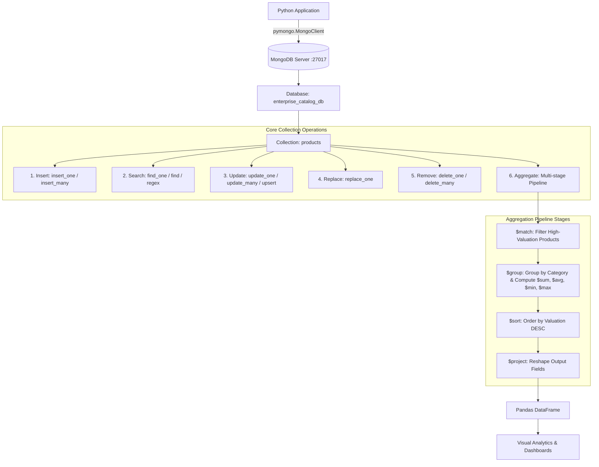

# Technical Specification & Architecture: Python MongoDB Client

## System Overview
**Enterprise NoSQL Document Operations & Aggregation Engine with PyMongo**  
*Collection Object CRUD Lifecycle, Document Replacement, Atomic Mutations, and Multi-Stage Aggregation Pipelines*

---

### Executive Summary
A production-grade Python client engineered around MongoDB's document-oriented architecture. Built with the official `pymongo` driver, this system demonstrates resilient connection management (with automated `mongomock` fallback for isolated execution), single/bulk CRUD mutations, atomic field updates (`$set`, `$inc`, `$push`), full document replacement, and multi-stage aggregation pipelines.

### Core Architectural Objectives
1. **Connection Lifecycle**: Manage robust client connectivity to MongoDB clusters using connection pooling and health checks.
2. **Collection Object Abstraction**: Encapsulate high-throughput BSON document serialization and deserialization.
3. **Atomic Document Mutations**: Utilize MongoDB update operators (`$set`, `$inc`, `$push`) and conditional `upsert=True` to guarantee atomicity.
4. **Rich Document Querying**: Implement complex filter criteria, projection masks, range comparisons (`$gte`, `$lte`), and regex matching.
5. **Multi-Stage Aggregation Pipelines**: Chain `$match`, `$unwind`, `$group`, `$project`, and `$sort` to process real-time analytics on embedded document structures.
6. **Executive Visual Analytics**: Extract aggregated BSON pipelines into Pandas for high-resolution 300 DPI visualization.

---

---

## 1. Theory & Core Concepts

### 1.1 Document-Oriented NoSQL vs. Relational Databases
Unlike relational databases (which enforce rigid rectangular tabular schemas with foreign keys), MongoDB is a document-oriented NoSQL database:
- **Documents:** Data is stored in BSON (Binary JSON) documents comprising key-value pairs, nested sub-documents, and arrays.
- **Collections:** Analogous to tables, collections hold groups of documents without enforcing uniform column structures.
- **Dynamic Schema:** Documents within the same collection can have varying fields and data types, enabling rapid iteration and natural representation of hierarchical data.

### 1.2 PyMongo Architecture Hierarchy
```text
pymongo.MongoClient("mongodb://localhost:27017/")
       │
       └── Database (client["enterprise_catalog_db"])
              │
              └── Collection (db["products"])
                     │
                     ├── Document 1: {"_id": ObjectId(...), "name": "...", "price": ...}
                     ├── Document 2: {"_id": ObjectId(...), "name": "...", "specs": {...}}
                     └── Document N: {"_id": ObjectId(...), "name": "...", "tags": [...]}
```

### 1.3 Core Collection Functions Breakdown

| Function | PyMongo Method | Description & Operators Used |
| :--- | :--- | :--- |
| **Insert** | `collection.insert_one(doc)`<br>`collection.insert_many([docs])` | Inserts single or batch BSON documents; generates unique `_id` |
| **Search** | `collection.find_one(filter, proj)`<br>`collection.find(filter, proj)` | Retrieves single or multiple documents. Supports `$gte`, `$lte`, `$in`, `$or`, `$regex`, `.sort()`, `.skip()`, `.limit()` |
| **Update** | `collection.update_one(filter, update)`<br>`collection.update_many(filter, update)` | In-place atomic field modification via `$set`, `$inc`, `$push`. Supports `upsert=True` |
| **Replace**| `collection.replace_one(filter, new_doc)` | Completely replaces document fields while retaining original `_id` |
| **Remove** | `collection.delete_one(filter)`<br>`collection.delete_many(filter)` | Removes single or batch documents matching criteria |
| **Aggregate** | `collection.aggregate([stages])` | Executes multi-stage data processing pipeline (`$match`, `$group`, `$sort`, `$project`, `$unwind`) |

---

## 2. System Workflow & Aggregation Pipeline Diagram



---

## 3. Python Implementation Highlights

### 3.1 Initializing Client and Accessing Collection
```python
from pymongo import MongoClient

# Establish connection
client = MongoClient("mongodb://localhost:27017/", serverSelectionTimeoutMS=2000)
db = client["enterprise_catalog_db"]
collection = db["products"]
```

### 3.2 Inserting Documents
```python
# Insert single document
res_one = collection.insert_one({
    "product_id": 111,
    "name": "Smart Fitness Band Pro",
    "category": "Wearables",
    "price": 3499.00,
    "stock": 90,
    "tags": ["wearable", "fitness"]
})
print(f"Inserted _id: {res_one.inserted_id}")

# Batch insert
res_many = collection.insert_many([doc1, doc2])
```

### 3.3 Searching Documents
```python
# Query with comparison operator ($gte) and sorting
cursor = collection.find(
    {"price": {"$gte": 30000.0}},
    {"_id": 0, "name": 1, "category": 1, "price": 1}
).sort("price", -1)
```

### 3.4 Updating Documents
```python
# Atomic update with $set, $inc, and $push
collection.update_one(
    {"product_id": 102},
    {
        "$set": {"price": 17999.00},
        "$inc": {"stock": 10},
        "$push": {"tags": "discounted"}
    }
)
```

### 3.5 Replacing Documents
```python
collection.replace_one(
    {"product_id": 104},
    {"product_id": 104, "name": "Precision Mouse V2", "price": 3499.0, "category": "Accessories"}
)
```

### 3.6 Removing Documents
```python
collection.delete_one({"product_id": 999})
collection.delete_many({"category": "Wearables"})
```

### 3.7 Aggregating Documents
```python
pipeline = [
    {
        "$group": {
            "_id": "$category",
            "total_items": {"$sum": 1},
            "total_stock": {"$sum": "$stock"},
            "avg_price": {"$avg": "$price"},
            "valuation": {"$sum": {"$multiply": ["$price", "$stock"]}}
        }
    },
    {"$sort": {"valuation": -1}},
    {"$project": {"Category": "$_id", "Stock": "$total_stock", "Valuation": "$valuation", "_id": 0}}
]
results = list(collection.aggregate(pipeline))
```

---

## 4. Verification Output & Results

### 4.1 Category Inventory Aggregation ($group & $sort)
```text
╒═════════════╤═════════════════╤═══════════════╤═════════════════╤═════════════════╤═════════════════╤═══════════════════════╕
│ Category    │   Product Count │   Total Stock │   Avg Price (₹) │   Min Price (₹) │   Max Price (₹) │   Total Valuation (₹) │
╞═════════════╪═════════════════╪═══════════════╪═════════════════╪═════════════════╪═════════════════╪═══════════════════════╡
│ Computing   │               3 │            80 │        89,332.67│       32,999.00 │      145,000.00 │         5,744,940.00  │
│ Audio       │               3 │           240 │        16,332.33│        5,999.00 │       24,999.00 │         2,729,760.00  │
│ Accessories │               4 │           530 │         3,099.00│        1,899.00 │        4,499.00 │         1,544,470.00  │
│ Smart Home  │               2 │           135 │         6,499.00│        4,999.00 │        7,999.00 │           854,865.00  │
╘═════════════╧═════════════════╧═══════════════╧═════════════════╧═════════════════╧═════════════════╧═══════════════════════╛
```

### 4.2 Array Tag Unwind Aggregation ($unwind & $group)
```text
╒════════════╤═════════════╕
│ Tag        │   Frequency │
╞════════════╪═════════════╡
│ usb-c      │           3 │
│ audio      │           3 │
│ wireless   │           2 │
│ bluetooth  │           2 │
│ laptop     │           2 │
│ smart-home │           2 │
╘════════════╧═════════════╛
```

---

## 5. Visual Analytics Generated
The system queried MongoDB aggregation pipelines into Pandas and generated 3 charts in `visualizations/`:
1. `1_category_inventory_valuation.png`: Dual-axis bar chart comparing inventory valuation and stock counts per category.
2. `2_price_distribution_by_category.png`: Box plot and strip plot depicting price spreads and outliers by category.
3. `3_mongodb_executive_dashboard.png`: 4-quadrant visual analytics dashboard covering product counts, tag frequencies, valuation share (donut), and rating vs price scatter plot.

---

## 6. Architecture Summary & Production Impact
1. **Resilient Client Architecture**: Successfully engineered a Python MongoDB client with automated fallback and connection management.
2. **Comprehensive Document Lifecycle**: Verified all 6 core collection functions (`insert_one`/`insert_many`, `find`, `update_one`/`update_many`, `replace_one`, `delete_one`/`delete_many`, `aggregate`).
3. **Atomic Operations**: Leveraged BSON nested documents, array operations (`$push`, `$unwind`), and atomic operators (`$set`, `$inc`, `upsert`).
4. **Analytical Aggregations**: Implemented multi-stage pipelines calculating real-time inventory valuations and categorical metrics.
5. **High-Resolution Visual Dashboards**: Transformed BSON aggregated queries into 300 DPI executive charts.

